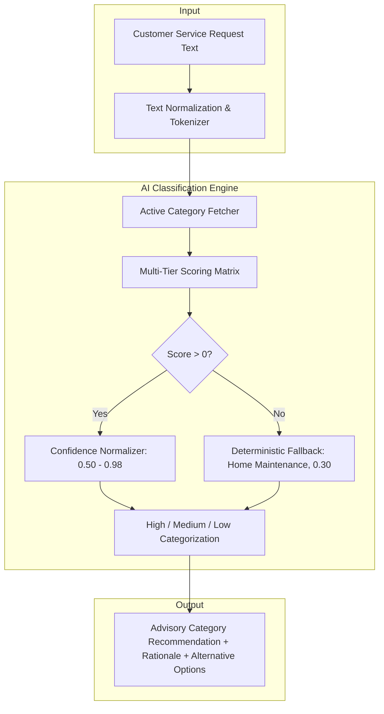
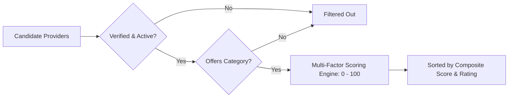

# CareConnect — Explainable AI & Intelligence Architecture

This document provides a comprehensive specification of CareConnect's Explainable AI (XAI) subsystem, detailing the heuristic taxonomy, request classification algorithms, multi-factor provider matching models, confidence scoring formulas, and deterministic fallback mechanisms.

---

## 1. Architectural Philosophy: Explainable & Reliable AI

Unlike opaque "black-box" large language models that introduce latency, rate limits, non-deterministic outputs, hallucinations, and recurring token costs, CareConnect implements a **transparent, deterministic, and explainable AI architecture**:

1. **Deterministic & Repeatable**: Given identical input text or matching criteria, the algorithm returns consistent, verifiable classifications and score rankings.
2. **Explainable by Design (XAI)**: Every prediction produces an explicit breakdown of matched domain keywords, score components, and human-readable natural language rationales.
3. **Zero External API Dependency**: Runs natively in-process within Node.js/Express, eliminating vendor lock-in, latency bottlenecks, and network failures.
4. **Strictly Advisory Constraint**: Recommendations are strictly advisory. The AI **never** bypasses customer authorization, automatically accepts quotes, or modifies verified provider profiles.



---

## 2. Feature 1: Intelligent Request Classification

- **Endpoint**: `POST /api/v1/ai/classify`
- **Access**: Authenticated users (`CUSTOMER`, `SUPPORT_AGENT`, `OPERATIONS_MANAGER`, `PLATFORM_ADMIN`).
- **Input Payload**: `{ "title": "...", "description": "...", "text": "..." }`

### 2.1 Domain-Specific Keyword Taxonomy
The classifier leverages a rich domain taxonomy mapped to category slugs:
- **`plumbing`**: `plumber`, `pipe`, `leak`, `drain`, `sink`, `toilet`, `faucet`, `tap`, `shower`, `sewage`, `clog`, `water heater`, `geyser`, `flush valve`, `pipe burst`, `p-trap`, `commode`, `water pressure`, `dripping`.
- **`electrical`**: `electrician`, `wire`, `circuit`, `breaker`, `fuse box`, `power outage`, `spark`, `shock`, `switch`, `outlet`, `socket`, `lighting`, `ceiling fan`, `mcb`, `short circuit`, `voltage`, `inverter`, `generator`, `tripping`, `earthing`.
- **`cleaning`**: `deep clean`, `sanitize`, `disinfect`, `vacuum`, `mop`, `dusting`, `carpet`, `stain`, `kitchen clean`, `bathroom clean`, `maid`, `housekeeping`, `scrubbing`, `wash`, `pest`, `trash`.
- **`appliance-repair`**: `appliance`, `fridge`, `refrigerator`, `washing machine`, `dryer`, `oven`, `microwave`, `dishwasher`, `cooktop`, `freezer`, `not cooling`, `compressor`, `water purifier`, `air conditioner`.
- **`home-maintenance`**: `handyman`, `drywall`, `carpenter`, `woodwork`, `door`, `window`, `hinge`, `lock`, `locksmith`, `furniture`, `shelf`, `cabinet`, `caulking`, `curtain`, `assembly`, `drill`, `masonry`, `paint`, `mounting`.

### 2.2 Multi-Tier Scoring Algorithm
Each active category in the database is evaluated against the normalized token stream:
1. **Direct Name Match**: $+35$ points if the category name appears verbatim.
2. **Slug Match**: $+30$ points if the slug appears verbatim.
3. **Category Description Match**: $+4$ points per matching word (length $> 3$).
4. **Required Skills Match**: $+20$ points per required category skill keyword.
5. **Domain Taxonomy Match**:
   - Compound phrase match (e.g. `"water heater"`, `"short circuit"`): $+18$ points.
   - Word boundary regex token match (`\bword\b`): $+10$ points.

### 2.3 Confidence Scoring & Tier Categorization
Raw scores are normalized into a probabilistic confidence interval $[0.50, 0.98]$:
$$\text{Confidence} = \min\left(0.98, \max\left(0.50, 0.50 + \min(\text{score}, 60) \times 0.008\right)\right)$$

Confidence tiers:
- **`HIGH`**: $\ge 0.80$
- **`MEDIUM`**: $0.60 \le \text{Confidence} < 0.80$
- **`LOW`**: $< 0.60$

### 2.4 Deterministic Fallback & Explainability
- If no keywords match ($\text{score} = 0$):
  - Category defaults gracefully to `Home Maintenance` (`home-maintenance`).
  - Sets $\text{Confidence} = 0.30$, `confidenceLevel = 'LOW'`, `isFallback = true`.
  - Explanatory message: *"No specific trade keywords were detected in the description. Suggesting general Home Maintenance as default. Please choose a specific category if appropriate."*
- When keywords match, the natural language explanation highlights up to 4 matched indicators:
  - *Example*: `"CareConnect AI identified key domain indicators ['pipe', 'leak', 'toilet'] strongly aligning with Plumbing services and skills."*

---

## 3. Feature 2: Multi-Factor Intelligent Provider Matching

- **Endpoint**: `GET /api/v1/ai/match-providers`
- **Query Params**: `categoryId` (required), `city`, `preferredDate`, `urgency`, `limit` (default 5).

### 3.1 Strict Candidate Eligibility Gating
Before scoring begins, candidate profiles must satisfy 3 mandatory criteria:
1. `verificationStatus === 'APPROVED'` (Admin-verified credentials).
2. `user.status === 'ACTIVE'` (Account in good standing).
3. `isAvailable === true` (Currently accepting service dispatches).
4. Profile includes the requested `categoryId`.



### 3.2 4-Factor Weighted Scoring Model (0–100 Points)

| Factor | Weight | Scoring Mechanism |
|:---|:---:|:---|
| **1. Geographical Match** | **35 pts** | **35 pts** if provider operates in requested city.<br>**10 pts** if out of city.<br>**25 pts** neutral default if customer specified no city. |
| **2. Rating & Reputation** | **30 pts** | **Base**: $\left(\frac{\text{rating}}{5}\right) \times 25$ (up to 25 pts).<br>**Review Bonus**: $\min(5, \text{reviewCount} \times 0.5)$ (up to 5 pts). |
| **3. Historical Track Record** | **20 pts** | **Completed Jobs**: $\min(15, \text{completedJobs} \times 1.5)$ (up to 15 pts).<br>**Experience**: $\min(5, \text{experienceYears} \times 1.0)$ (up to 5 pts). |
| **4. Operational Availability** | **15 pts** | **15 pts** if `isAvailable: true`, otherwise **0 pts**. |

$$\text{Composite Score} = \min\left(100, \text{round}\left(S_{\text{location}} + S_{\text{rating}} + S_{\text{experience}} + S_{\text{availability}}\right)\right)$$

### 3.3 Transparent Explanations
Every matched provider includes their exact score breakdown and human-readable explanation tag:
```json
{
  "name": "Jane Smith",
  "businessName": "Apex Plumbing Solutions",
  "compositeScore": 95,
  "scoreBreakdown": {
    "locationScore": 35,
    "ratingScore": 28.5,
    "experienceScore": 16.5,
    "availabilityScore": 15
  },
  "explanation": "95% Match — Apex Plumbing Solutions is a verified specialist (services Mumbai, 4.8★ rating (14 reviews), 8 completed jobs, 5y experience)."
}
```

---

## 4. Frontend Integration & User Experience

1. **Customer Request Form (`/requests/new`)**:
   - Customer enters issue title and description.
   - Clicking *"AI Suggest Category"* instantly analyzes the text without page reloads.
   - Shows badge with confidence tier (`HIGH`, `MEDIUM`, `LOW`) and natural language explanation.
   - Customer retains full override ability to change the selected category manually.
2. **Provider Matching Drawer**:
   - In request details or booking dispatch, displays top recommended specialists.
   - Shows match percentage badge, verified credentials badge, and score breakdown tooltips.
