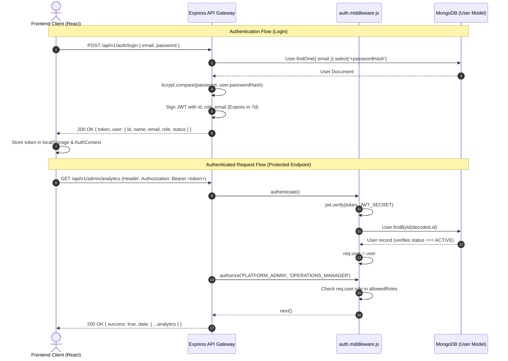

# CareConnect — Authentication & Role-Based Access Control (RBAC) Reference

This document details the security architecture, authentication lifecycle, JWT token management, password hashing protocols, and granular Role-Based Access Control (RBAC) model implemented in CareConnect.

---

## 1. Authentication Architecture Overview

CareConnect uses stateless, token-based authentication built on JSON Web Tokens (JWT) and industry-standard salted hashing with `bcryptjs`. 



---

## 2. Password Security & Hashing

- **Algorithm**: Salted Blowfish cipher (`bcryptjs`).
- **Salt Work Factor**: 12 salt rounds (`bcrypt.genSalt(12)`).
- **Storage Isolation**: The `passwordHash` field is marked with `select: false` in the Mongoose schema. Default queries (`find`, `findById`) never return the hash unless explicitly requested with `.select('+passwordHash')`.
- **Serialization Sanitization**: The schema's `toJSON` transform hook explicitly deletes `passwordHash` and `__v` before document serialization to prevent credential leakage.

---

## 3. JWT Token Lifecycle & Headers

- **Format**: Bearer Token via standard HTTP header:
  ```http
  Authorization: Bearer <jwt_token_string>
  ```
- **Token Claims / Payload**:
  ```json
  {
    "id": "64d0a1b2c3d4e5f6a7b8c9d0",
    "email": "customer@careconnect.test",
    "role": "CUSTOMER",
    "iat": 1729000000,
    "exp": 1729604800
  }
  ```
- **Secret & Expiration**: Configured via `JWT_SECRET` and `JWT_EXPIRES_IN` (defaults to 7 days).
- **Error Handling**: Expired, tampered, or malformed tokens yield immediate HTTP `401 Unauthorized` responses handled by central error middleware.

---

## 4. Account Lifecycle & Status Gating

Before any authenticated route executes, `authenticate()` verifies account status:
- `ACTIVE`: Access permitted.
- `SUSPENDED`: Access rejected with `403 Forbidden` (`"Your account has been suspended. Please contact support."`).
- `INACTIVE`: Access rejected with `403 Forbidden` (`"Your account is inactive. Please contact support."`).
- `PENDING`: Access rejected with `403 Forbidden` (`"Your account is pending verification."`).

---

## 5. Granular 5-Role Access Control Matrix

CareConnect classifies users into 5 distinct roles:
1. `CUSTOMER`: Homeowner / consumer booking services.
2. `SERVICE_PROVIDER`: Verified tradesperson or technician executing services.
3. `SUPPORT_AGENT`: Customer support and conflict mediator.
4. `OPERATIONS_MANAGER`: Platform supervisor monitoring fulfillment and dispatching.
5. `PLATFORM_ADMIN`: Superuser controlling taxonomy, provider approvals, and configuration.

### Comprehensive Permission & Endpoint Matrix

| Domain / Resource | Action | Customer | Provider | Support Agent | Operations Manager | Platform Admin |
|:---|:---|:---:|:---:|:---:|:---:|:---:|
| **Auth** | Register / Login | Any | Any | Any | Any | Any |
| | Get Current Profile (`/auth/me`) | Own | Own | Own | Own | Own |
| **Service Categories** | Read Active Categories | Yes | Yes | Yes | Yes | Yes |
| | Create / Update / Delete Category | No | No | No | No | **Yes** |
| **Provider Profiles** | View Public Directory | Yes | Yes | Yes | Yes | Yes |
| | Manage Own Profile & Docs | No | **Own** | No | No | No |
| | Admin Provider Approval / Rejection | No | No | No | No | **Yes** |
| **Service Requests** | Create Request | **Yes** | No | No | No | No |
| | Read Own Requests | **Own** | No | No | No | No |
| | Read Matching Marketplace Requests | No | **Yes** | No | Yes | Yes |
| | View Single Request Details | **Own** | If Quoted | Yes | Yes | Yes |
| **Quotes** | Submit Quote | No | **Yes** | No | No | No |
| | Read Quotes on Request | **Request Owner** | **Own** | Yes | Yes | Yes |
| | Accept / Reject Quote | **Request Owner** | No | No | No | No |
| **Bookings** | Create Booking from Quote | **Yes** | No | No | No | No |
| | View Bookings | **Own** | **Own** | All | All | All |
| | Cancel Booking | **Own** | **Own** | **Yes** | **Yes** | **Yes** |
| **Jobs** | Status (Start / Complete) | No | **Assigned** | No | Yes | Yes |
| | Upload Completion Evidence | No | **Assigned** | No | No | Yes |
| | Track Job Milestone | **Customer** | **Assigned** | Yes | Yes | Yes |
| **Invoices** | View Invoice | **Own** | **Own** | Yes | Yes | Yes |
| | Pay / Settle Invoice | **Customer** | No | No | Yes | Yes |
| **Reviews** | Submit Review | **Job Customer** | No | No | No | No |
| | Read Reviews | Public | Public | Public | Public | Public |
| **Disputes** | Raise Dispute | **Own Booking** | **Own Booking** | No | No | No |
| | Resolve / Refund Dispute | No | No | **Yes** | **Yes** | **Yes** |
| **Support Tickets** | Create Ticket | **Yes** | **Yes** | No | No | No |
| | Reply to Ticket (Public) | **Owner** | **Owner** | **Yes** | **Yes** | **Yes** |
| | Add Internal Staff Note | No | No | **Yes** | **Yes** | **Yes** |
| | Assign / Resolve Ticket | No | No | **Yes** | **Yes** | **Yes** |
| **Analytics** | View Trends & Performance | No | No | No | **Yes** | **Yes** |
| **User Admin** | List Users / Modify User Status | No | No | No | No | **Yes** |
| **Audit Logs** | Query Audit Trails | No | No | No | No | **Yes** |

---

## 6. Server-Side Enforcement vs. Client-Side Guards

### Server-Side Enforcement (Primary Defense)
All authorization is strictly validated on every HTTP request inside Express via:
```javascript
router.get(
  '/admin/analytics/overview',
  authenticate,
  authorize(ROLES.PLATFORM_ADMIN, ROLES.OPERATIONS_MANAGER),
  analyticsController.getOverview
);
```
Even if a malicious actor bypasses client route guards, the backend rejects the request with HTTP `403 Forbidden` (`Access denied: Role [...] does not have required permissions`).

### Client-Side Route Guards (UX Optimization)
In the React frontend, `ProtectedRoute` checks the current logged-in role from `AuthContext`:
```jsx
<Route
  path="/admin/*"
  element={
    <ProtectedRoute allowedRoles={[ROLES.PLATFORM_ADMIN]}>
      <AdminDashboard />
    </ProtectedRoute>
  }
/>
```
Unauthorized route navigation redirects users to their designated role dashboard:
- `CUSTOMER` $\to$ `/dashboard`
- `SERVICE_PROVIDER` $\to$ `/provider/dashboard`
- `SUPPORT_AGENT` $\to$ `/support/dashboard`
- `OPERATIONS_MANAGER` $\to$ `/operations/dashboard`
- `PLATFORM_ADMIN` $\to$ `/admin/dashboard`
