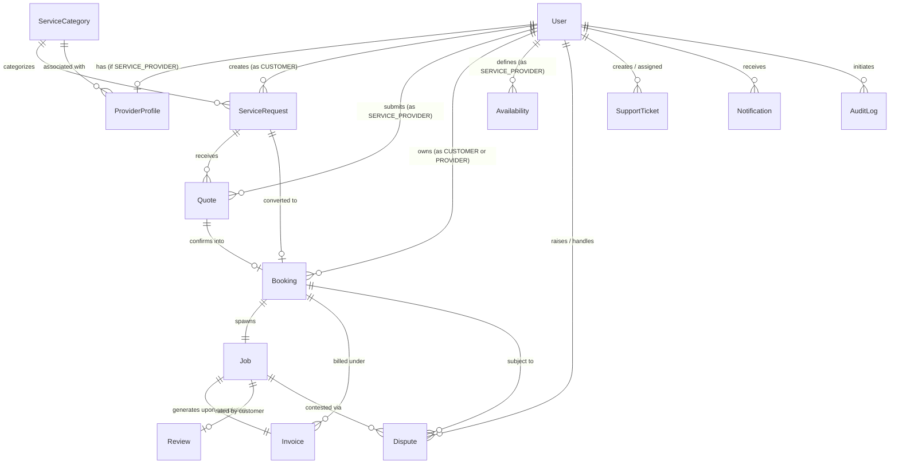

# CareConnect — Database Models & Schema Reference

This document provides a comprehensive technical reference for the 14 MongoDB/Mongoose models comprising the CareConnect data architecture. It details data schemas, field types, relationships, indexes, pre/post hooks, and constraints.

---

## 1. Entity Relationship Overview

The CareConnect data layer connects customers, providers, administrative staff, service requests, operational work orders, financial transactions, feedback, and customer support.

---

## 2. Core Principal Models

### 2.1 `User`
Represents all system actors across the 5 RBAC roles.

- **Collection**: `users`
- **Fields**:
  - `name`: `String` (Required, trim, min 2, max 100)
  - `email`: `String` (Required, unique, lowercase, trimmed, validated via RFC regex, indexed)
  - `passwordHash`: `String` (Required, select: `false`, bcrypt salted with cost factor 12)
  - `phone`: `String` (Optional, trimmed, default `""`)
  - `role`: `String` (Enum: `CUSTOMER`, `SERVICE_PROVIDER`, `SUPPORT_AGENT`, `OPERATIONS_MANAGER`, `PLATFORM_ADMIN`, default `CUSTOMER`, indexed)
  - `status`: `String` (Enum: `ACTIVE`, `SUSPENDED`, `PENDING_VERIFICATION`, default `ACTIVE`, indexed)
  - `createdAt`: `Date` (Automated timestamp)
  - `updatedAt`: `Date` (Automated timestamp)
- **Indexes**:
  - `{ email: 1 }` (Unique)
  - `{ role: 1, status: 1 }` (Compound index for staff lookups and operational audits)
- **Hooks & Methods**:
  - `pre('validate')`: Normalizes `email` to lowercase and trimmed string.
  - `pre('save')`: Hashes `passwordHash` using `bcrypt.genSalt(12)` when modified.
  - `methods.comparePassword(candidate)`: Asynchronous bcrypt compare method.
  - `toJSON`: Strips `passwordHash` and `__v` from serialization.

---

### 2.2 `ProviderProfile`
Maintains business credentials, service catalogs, geographical operational areas, pricing configurations, and administrative verification status.

- **Collection**: `providerprofiles`
- **Fields**:
  - `user`: `ObjectId` (Ref `User`, Required, unique, indexed)
  - `businessName`: `String` (Optional, trimmed)
  - `description`: `String` (Optional, trimmed)
  - `skills`: `[String]` (List of skills/specializations)
  - `serviceCategories`: `[ObjectId]` (Ref `ServiceCategory`, indexed)
  - `serviceAreas`: Subdocument array:
    - `city`: `String` (Required, trimmed)
    - `areas`: `[String]` (Neighborhoods/sub-regions)
  - `experienceYears`: `Number` (Default 0, min 0)
  - `pricing`: Subdocument:
    - `model`: `String` (Enum: `FIXED`, `HOURLY`, `STARTING_FROM`, `QUOTE_REQUIRED`, default `HOURLY`)
    - `minimumCharge`: `Number` (Min 0, default 0)
    - `hourlyRate`: `Number` (Min 0, default 0)
  - `hourlyRate`: `Number` (Legacy fallback, synchronized with `pricing.hourlyRate`)
  - `verificationStatus`: `String` (Enum: `PENDING`, `APPROVED`, `REJECTED`, `SUSPENDED`, default `PENDING`, indexed)
  - `verificationNotes`: `String` (Staff internal review notes)
  - `documents`: Subdocument array:
    - `type`: `String` (Enum: `IDENTITY`, `ADDRESS_PROOF`, `CERTIFICATION`, `BUSINESS_LICENSE`, `OTHER`)
    - `name`: `String` (Document label)
    - `url`: `String` (Direct URL or storage path)
    - `status`: `String` (Enum: `PENDING`, `VERIFIED`, `REJECTED`, default `PENDING`)
    - `uploadedAt`: `Date` (Default `Date.now`)
    - `verifiedAt`: `Date` (Timestamp when approved)
  - `rating`: `Number` (Float 0–5, rolling average)
  - `reviewCount`: `Number` (Total count of completed customer reviews)
  - `isAvailable`: `Boolean` (Operational dispatch toggle, default `true`, indexed)
- **Indexes**:
  - `{ user: 1 }` (Unique)
  - `{ serviceCategories: 1, verificationStatus: 1 }` (Provider discovery)
  - `{ 'serviceAreas.city': 1, verificationStatus: 1 }` (City-level matching)
  - `{ rating: -1, verificationStatus: 1 }` (Top-rated provider ranking)

---

### 2.3 `Availability`
Defines provider weekly operating shifts and blocked dates for scheduling.

- **Collection**: `availabilities`
- **Fields**:
  - `provider`: `ObjectId` (Ref `User`, Required, indexed)
  - `providerProfile`: `ObjectId` (Ref `ProviderProfile`, Required, indexed)
  - `dayOfWeek`: `String` (Enum: `MONDAY`, `TUESDAY`, `WEDNESDAY`, `THURSDAY`, `FRIDAY`, `SATURDAY`, `SUNDAY`, accepts numeric 0–6)
  - `startTime`: `String` (24-hr format `"09:00"`, Required)
  - `endTime`: `String` (24-hr format `"17:00"`, Required)
  - `isAvailable`: `Boolean` (Default `true`)
  - `isBlocked`: `Boolean` (Default `false`)
  - `blockedDate`: `Date` (Calendar date override)
- **Indexes**:
  - `{ providerProfile: 1, dayOfWeek: 1 }`
  - `{ provider: 1, dayOfWeek: 1 }`

---

## 3. Marketplace & Service Catalog Models

### 3.1 `ServiceCategory`
Taxonomy of service verticals with baseline pricing models and skill requirements.

- **Collection**: `servicecategories`
- **Fields**:
  - `name`: `String` (Required, unique, trimmed, min 2, max 100)
  - `slug`: `String` (Required, unique, lowercase, trimmed, indexed)
  - `description`: `String` (Overview of category)
  - `icon`: `String` (Lucide icon identifier, default `"Wrench"`)
  - `startingPrice`: `Number` (Min 0, default 0)
  - `pricingUnit`: `String` (Enum: `FIXED`, `HOURLY`, `STARTING_FROM`, `QUOTE_REQUIRED`, default `STARTING_FROM`)
  - `requiredSkills`: `[String]`
  - `isActive`: `Boolean` (Default `true`, indexed)
- **Virtuals**:
  - `basePriceEstimate`: Maps directly to `startingPrice` for backward compatibility.

---

### 3.2 `ServiceRequest`
Customer service orders awaiting provider bids or platform matching.

- **Collection**: `servicerequests`
- **Fields**:
  - `customer`: `ObjectId` (Ref `User`, Required, indexed)
  - `category`: `ObjectId` (Ref `ServiceCategory`, Required, indexed)
  - `title`: `String` (Required, min 5, max 120 chars)
  - `description`: `String` (Required, min 15, max 2000 chars)
  - `location`: Subdocument:
    - `address`: `String` (Required)
    - `city`: `String` (Required)
    - `postalCode`: `String` (Required)
    - `state`: `String` (Default `""`)
    - `coordinates`: `[Number]` (GeoJSON `[longitude, latitude]`, 2dsphere indexed)
  - `preferredDate`: `Date` (Required)
  - `preferredTime`: Subdocument `{ start: String, end: String }` (Default `09:00` - `12:00`)
  - `preferredTimeSlot`: `String` (Legacy alias, default `"MORNING"`)
  - `requiredSkills`: `[String]`
  - `status`: `String` (Enum: `DRAFT`, `SUBMITTED`, `MATCHING`, `QUOTED`, `BOOKED`, `CANCELLED`, default `SUBMITTED`, indexed)
  - `aiClassification`: Advisory AI metadata:
    - `predictedCategory`: `String`
    - `confidenceScore`: `Number` (Float 0–1)
    - `extractedUrgency`: `String` (Enum: `LOW`, `MEDIUM`, `HIGH`, `EMERGENCY`)
    - `tags`: `[String]`
    - `processedAt`: `Date`
  - `assignedProvider`: `ObjectId` (Ref `User`, optional provider assignment)
- **Indexes**:
  - `{ customer: 1, status: 1 }`
  - `{ category: 1, status: 1 }`
  - `{ preferredDate: 1, status: 1 }`
  - `{ 'location.city': 1, status: 1 }`
  - `{ 'location.coordinates': '2dsphere' }`

---

### 3.3 `Quote`
Provider bids submitted on open customer Service Requests.

- **Collection**: `quotes`
- **Fields**:
  - `serviceRequest`: `ObjectId` (Ref `ServiceRequest`, Required, indexed)
  - `provider`: `ObjectId` (Ref `User`, Required, indexed)
  - `providerProfile`: `ObjectId` (Ref `ProviderProfile`, Required, indexed)
  - `amount`: `Number` (Required, min 0.01)
  - `currency`: `String` (Default `'INR'`, enum: `['INR']`)
  - `estimatedDuration`: `Number` (Hours, min 0.1)
  - `description`: `String` (Scope of work and equipment included, min 5, max 2000)
  - `status`: `String` (Enum: `SUBMITTED`, `ACCEPTED`, `REJECTED`, `EXPIRED`, `WITHDRAWN`, default `SUBMITTED`, indexed)
  - `validUntil`: `Date` (Expiration timestamp, Required)
- **Backward Compatibility Sync**:
  - Auto-synchronizes `estimatedPrice` with `amount`, `estimatedDurationHours` with `estimatedDuration`, `message` with `description`, and `expiresAt` with `validUntil`.
- **Indexes**:
  - `{ serviceRequest: 1, provider: 1 }` (Prevents duplicate quotes per provider per request)
  - `{ provider: 1, status: 1 }`
  - `{ serviceRequest: 1, status: 1 }`

---

## 4. Operational & Fulfillment Models

### 4.1 `Booking`
Legally and operationally confirmed booking contracts between customer and provider.

- **Collection**: `bookings`
- **Fields**:
  - `serviceRequest`: `ObjectId` (Ref `ServiceRequest`, Required, indexed)
  - `customer`: `ObjectId` (Ref `User`, Required, indexed)
  - `provider`: `ObjectId` (Ref `User`, Required, indexed)
  - `providerProfile`: `ObjectId` (Ref `ProviderProfile`, Required, indexed)
  - `quote`: `ObjectId` (Ref `Quote`, indexed)
  - `scheduledStart`: `Date` (Required, indexed)
  - `scheduledEnd`: `Date` (Required)
  - `price`: `Number` (Required, min 0)
  - `currency`: `String` (Default `'INR'`)
  - `status`: `String` (Enum: `CONFIRMED`, `IN_PROGRESS`, `COMPLETED`, `CANCELLED`, `DISPUTED`, default `CONFIRMED`, indexed)
  - `cancellationReason`: `String`
  - `cancelledBy`: `ObjectId` (Ref `User`)
  - `cancelledAt`: `Date`
  - `cancellation`: Subdocument `{ cancelledBy: ObjectId, cancelledAt: Date, reason: String, refundAmount: Number }`
- **Hooks**:
  - `pre('validate')`: Synchronizes flat cancellation fields with nested `cancellation` subdocument.
- **Indexes**:
  - `{ provider: 1, scheduledStart: 1, scheduledEnd: 1 }` (Conflict detection)
  - `{ customer: 1, status: 1 }`
  - `{ provider: 1, status: 1 }`
  - `{ scheduledStart: 1, status: 1 }`

---

### 4.2 `Job`
Tracks physical execution, proof of service, milestone transitions, and completion evidence.

- **Collection**: `jobs`
- **Fields**:
  - `booking`: `ObjectId` (Ref `Booking`, Required, unique, indexed)
  - `provider`: `ObjectId` (Ref `User`, Required, indexed)
  - `customer`: `ObjectId` (Ref `User`, Required, indexed)
  - `status`: `String` (Enum: `ASSIGNED`, `EN_ROUTE`, `IN_PROGRESS`, `COMPLETED`, `CANCELLED`, default `ASSIGNED`, indexed)
  - `startedAt`: `Date`
  - `completedAt`: `Date`
  - `serviceEvidence`: Subdocument array:
    - `url`: `String` (Image/report URL)
    - `description`: `String`
    - `uploadedAt`: `Date` (Default `Date.now`)
  - `notes`: `String`
- **Indexes**:
  - `{ booking: 1 }` (Unique)
  - `{ provider: 1, status: 1 }`
  - `{ customer: 1, status: 1 }`

---

### 4.3 `Invoice`
Financial accounting, payment status, and platform revenue commission split.

- **Collection**: `invoices`
- **Fields**:
  - `invoiceNumber`: `String` (Unique human-readable invoice code, e.g. `INV-2026-XXXXX`, indexed)
  - `booking`: `ObjectId` (Ref `Booking`, Required, indexed)
  - `job`: `ObjectId` (Ref `Job`, Required, unique, indexed)
  - `quote`: `ObjectId` (Ref `Quote`)
  - `customer`: `ObjectId` (Ref `User`, Required, indexed)
  - `provider`: `ObjectId` (Ref `User`, Required, indexed)
  - `subtotal`: `Number` (Pre-tax service cost, min 0)
  - `platformFee`: `Number` (Platform fee share, default 0)
  - `tax`: `Number` (Tax component, default 0)
  - `totalAmount`: `Number` (Payable total in integer cents or exact units, min 0)
  - `status`: `String` (Enum: `ISSUED`, `PAID`, `CANCELLED`, `REFUNDED`, default `ISSUED`, indexed)
  - `paidAt`: `Date`
- **Indexes**:
  - `{ invoiceNumber: 1 }` (Unique)
  - `{ job: 1 }` (Unique)
  - `{ booking: 1 }`
  - `{ customer: 1 }`
  - `{ provider: 1 }`

---

### 4.4 `Review`
Customer ratings and reviews on completed jobs.

- **Collection**: `reviews`
- **Fields**:
  - `job`: `ObjectId` (Ref `Job`, Required, unique, indexed)
  - `booking`: `ObjectId` (Ref `Booking`, Required, indexed)
  - `customer`: `ObjectId` (Ref `User`, Required, indexed)
  - `provider`: `ObjectId` (Ref `User`, Required, indexed)
  - `providerProfile`: `ObjectId` (Ref `ProviderProfile`, indexed)
  - `rating`: `Number` (Required, Integer 1–5)
  - `comment`: `String` (Max 1000 chars, default `""`)
- **Indexes**:
  - `{ job: 1 }` (Unique - ensures exactly one review per fulfilled job)
  - `{ provider: 1, rating: -1 }`
  - `{ providerProfile: 1, rating: -1 }`
  - `{ customer: 1, createdAt: -1 }`

---

## 5. Governance, Support & System Models

### 5.1 `Dispute`
Arbitration and refund management for contested bookings or jobs.

- **Collection**: `disputes`
- **Fields**:
  - `booking`: `ObjectId` (Ref `Booking`, Required, indexed)
  - `job`: `ObjectId` (Ref `Job`, Required, indexed)
  - `customer`: `ObjectId` (Ref `User`, Required, indexed)
  - `provider`: `ObjectId` (Ref `User`, Required, indexed)
  - `raisedBy`: `ObjectId` (Ref `User`, Required, indexed)
  - `reason`: `String` (Required, summary issue)
  - `category`: `String` (Default `'GENERAL'`)
  - `description`: `String` (Required detailed narrative)
  - `status`: `String` (Enum: `OPEN`, `UNDER_REVIEW`, `RESOLVED`, `REJECTED`, default `OPEN`, indexed)
  - `resolution`: Subdocument:
    - `resolvedBy`: `ObjectId` (Ref `User` - staff member)
    - `resolvedAt`: `Date`
    - `resolutionNotes`: `String`
    - `refundApproved`: `Boolean` (Default `false`)
    - `refundAmount`: `Number` (Default 0)
- **Indexes**:
  - `{ job: 1, status: 1 }`
  - `{ customer: 1, createdAt: -1 }`
  - `{ provider: 1, createdAt: -1 }`

---

### 5.2 `SupportTicket`
Staff ticketing system with threaded messages, internal agent notes, and priority queues.

- **Collection**: `supporttickets`
- **Fields**:
  - `ticketNumber`: `String` (Unique ticket ID, e.g. `TCK-XXXXX`, indexed)
  - `createdBy`: `ObjectId` (Ref `User`, Required, indexed)
  - `customer`: `ObjectId` (Ref `User`, indexed)
  - `provider`: `ObjectId` (Ref `User`, indexed)
  - `assignedTo`: `ObjectId` (Ref `User` - staff assignee, indexed)
  - `subject`: `String` (Required, min 5, max 150)
  - `description`: `String` (Required, min 10, max 3000)
  - `category`: `String` (Enum: `ACCOUNT`, `BOOKING`, `PAYMENT`, `TECHNICAL`, `DISPUTE`, `OTHER`, default `OTHER`, indexed)
  - `priority`: `String` (Enum: `LOW`, `MEDIUM`, `HIGH`, `URGENT`, default `MEDIUM`, indexed)
  - `status`: `String` (Enum: `OPEN`, `IN_PROGRESS`, `WAITING_ON_CUSTOMER`, `RESOLVED`, `CLOSED`, default `OPEN`, indexed)
  - `relatedBooking`: `ObjectId` (Ref `Booking`, indexed)
  - `relatedJob`: `ObjectId` (Ref `Job`, indexed)
  - `relatedDispute`: `ObjectId` (Ref `Dispute`, indexed)
  - `messages`: Subdocument array:
    - `sender`: `ObjectId` (Ref `User`, Required)
    - `senderRole`: `String` (Required)
    - `message`: `String` (Required, max 2000)
    - `isInternal`: `Boolean` (Default `false` - restricted to staff)
    - `createdAt`: `Date`
  - `resolution`: Subdocument `{ resolvedBy: ObjectId, resolvedAt: Date, resolutionNotes: String }`
  - `closedAt`: `Date`
- **Indexes**:
  - `{ ticketNumber: 1 }` (Unique)
  - `{ createdBy: 1, status: 1 }`
  - `{ assignedTo: 1, status: 1 }`
  - `{ status: 1, priority: 1 }`

---

### 5.3 `Notification`
Real-time and in-app system notifications for transactional milestones.

- **Collection**: `notifications`
- **Fields**:
  - `recipient`: `ObjectId` (Ref `User`, Required, indexed)
  - `title`: `String` (Required)
  - `message`: `String` (Required)
  - `type`: `String` (Notification category identifier, indexed)
  - `read`: `Boolean` (Default `false`, indexed)
  - `isRead`: `Boolean` (Default `false`, indexed, synchronized with `read`)
  - `readAt`: `Date` (Timestamp when read, default `null`)
  - `data`: `Mixed` (Payload object containing contextual deep link identifiers)
  - `relatedBooking`: `ObjectId` (Ref `Booking`)
  - `relatedJob`: `ObjectId` (Ref `Job`)
  - `relatedInvoice`: `ObjectId` (Ref `Invoice`)
  - `relatedReview`: `ObjectId` (Ref `Review`)
  - `relatedDispute`: `ObjectId` (Ref `Dispute`)
  - `relatedSupportTicket`: `ObjectId` (Ref `SupportTicket`)
- **Indexes**:
  - `{ recipient: 1, createdAt: -1 }` (Recent notifications feed)
  - `{ recipient: 1, read: 1 }` (Unread counter query)
  - `{ recipient: 1, isRead: 1 }` (Unread counter query compatibility)

---

### 5.4 `AuditLog`
Append-only immutable audit trail capturing administrative modifications, status changes, and privileged operations.

- **Collection**: `auditlogs`
- **Fields**:
  - `actor`: `ObjectId` (Ref `User`, User performing action, indexed)
  - `action`: `String` (Action verb, e.g. `USER_STATUS_UPDATE`, `PROVIDER_VERIFY`, `DISPUTE_RESOLVE`, indexed)
  - `targetType`: `String` (Entity name, e.g. `'User'`, `'Booking'`, `'ProviderProfile'`)
  - `targetId`: `ObjectId` (Target entity identifier, indexed)
  - `details`: `Mixed` (Payload diff or metadata snapshot)
  - `ipAddress`: `String`
  - `userAgent`: `String`
  - `createdAt`: `Date` (Automated timestamp)
- **Special Configurations**:
  - `timestamps: { createdAt: true, updatedAt: false }` enforces append-only immutability. No updates permitted.
- **Indexes**:
  - `{ actor: 1, createdAt: -1 }`
  - `{ action: 1, createdAt: -1 }`
  - `{ targetId: 1, createdAt: -1 }`
