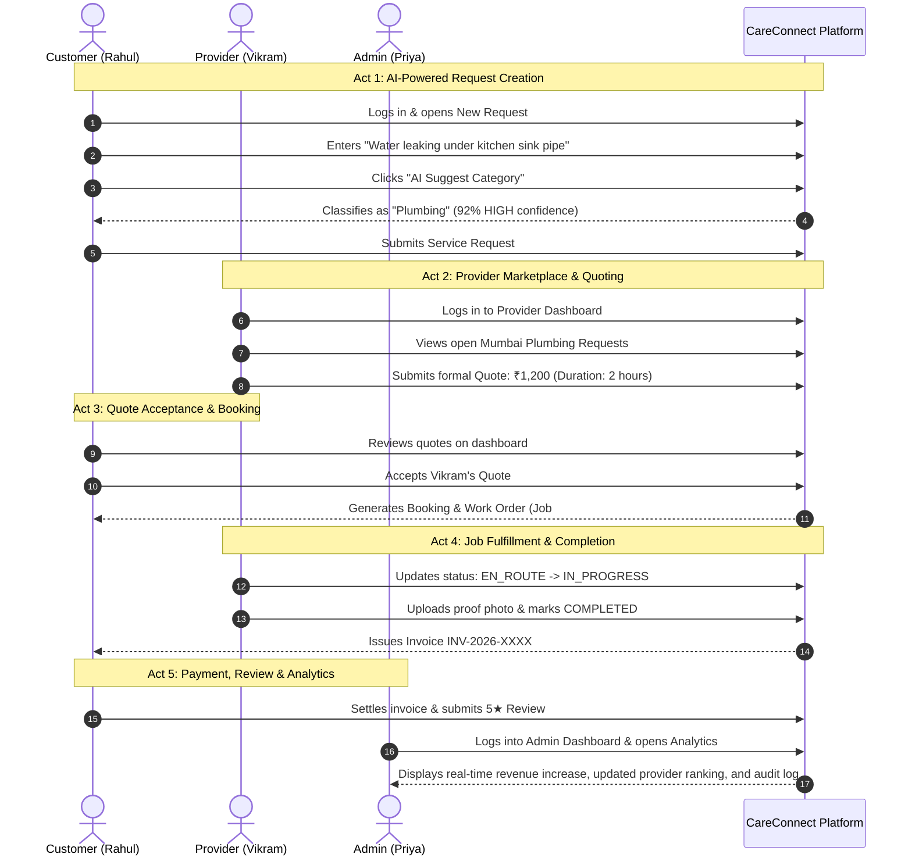

# CareConnect — Capstone Live Demo Script & Viva Voce Preparation Guide

This guide is designed for project evaluators, professors, viva panels, and student presenters. It includes a chronological 5–10 minute demonstration script, role checklists, 25+ academic viva questions with in-depth answers, and an honest evaluation of platform limitations and future roadmaps.

---

## 1. 5–10 Minute Live Demonstration Script

### Demo Persona Narrative
- **Customer**: *Rahul Sharma* (`customer@careconnect.test`) — Experiencing a plumbing pipe leak in his kitchen.
- **Provider**: *Vikram Singh* (`vikram@careconnect.test`) — Verified professional plumber operating in Mumbai.
- **Admin / Operations**: *Priya Patel* (`admin@careconnect.test`) — Platform Administrator monitoring dispatch and platform metrics.

---

### Step-by-Step Demo Flow

#### Act 1: Customer Creates Request with AI Classification (2 mins)
1. Log in as Customer (`customer@careconnect.test`).
2. Navigate to **Service Requests** $\to$ **New Request** (`/requests/new`).
3. Enter title: `"Severe pipe leak under the kitchen sink"`.
4. Enter description: `"The p-trap pipe burst under our kitchen sink and is flooding the cabinet. Need urgent plumbing assistance."`
5. Click **"AI Suggest Category"**:
   - **Show Panel**: Observe that the heuristic classifier detects `"pipe"`, `"leak"`, `"p-trap"` and automatically selects **Plumbing** with a **HIGH confidence badge (92%)** and a transparent explanation badge.
6. Enter address details (City: `Mumbai`), preferred date, and submit.

#### Act 2: Provider Reviews Marketplace & Submits Quote (2 mins)
1. In an Incognito window or after logging out, log in as Provider (`vikram@careconnect.test`).
2. Navigate to **Available Requests** (`/provider/requests`).
3. Click on Rahul's newly posted Mumbai plumbing request.
4. Click **Submit Quote**:
   - Enter Amount: `₹1,200`.
   - Enter Duration: `2 hours`.
   - Enter Note: `"I have replacement PVC joints and silicone sealant ready. Can visit today at 3 PM."`
5. Submit the quote.

#### Act 3: Customer Accepts Quote & Confirms Booking (1 min)
1. Switch back to Rahul's customer session.
2. Open the request page. Notice Vikram's quote in the **Submitted Quotes** section.
3. Click **Accept Quote**:
   - The platform converts the quote into a confirmed **Booking** and automatically provisions a trackable **Job** record.

#### Act 4: Provider Executes Service & Submits Proof (2 mins)
1. Switch to Vikram's provider dashboard (`/provider/bookings`).
2. Click **Start Job** $\to$ status moves to `IN_PROGRESS`.
3. Click **Upload Completion Evidence**:
   - Enter image URL and completion note: `"Replaced cracked P-trap connector and verified pressure seal."`
4. Click **Mark as Completed**:
   - Status updates to `COMPLETED`. The platform automatically generates an official **Invoice** with subtotal and platform fee.

#### Act 5: Invoice Payment, Review & Executive Analytics (2 mins)
1. As Rahul, open **My Invoices** $\to$ Click **Pay Invoice**.
2. Click **Leave Review** $\to$ Submit a 5-star rating with review: `"Fast arrival and professional repair!"`.
3. Log in as Platform Admin (`admin@careconnect.test`).
4. Navigate to **Analytics** (`/admin/analytics`):
   - **Show Panel**: Highlight the updated revenue charts, completed booking counters, top category demand, and Vikram's updated rating on the provider leaderboard.
5. Navigate to **Audit Logs**:
   - Point out the immutable audit trail verifying each transition.

---

## 2. Role-by-Role Journey Checklists

### Customer Checklist
- [x] Register new account or log in with existing credentials.
- [x] Create a service request using AI category suggestion.
- [x] Browse available quotes from verified providers.
- [x] Accept preferred quote to generate a binding booking.
- [x] Track active job status (`ASSIGNED` $\to$ `EN_ROUTE` $\to$ `IN_PROGRESS` $\to$ `COMPLETED`).
- [x] View and settle official invoices.
- [x] Post ratings and feedback on completed work orders.
- [x] Raise a dispute if service quality is unacceptable.
- [x] Open support tickets with customer care.

### Service Provider Checklist
- [x] Register provider account and submit verification documents.
- [x] Configure operating cities, skills, and pricing models.
- [x] Manage weekly shifts and block out blackout dates.
- [x] Browse matching requests in the open marketplace.
- [x] Submit formal competitive price quotes.
- [x] Update job milestones and upload proof-of-work photos.
- [x] Review job history and earnings dashboards.

### Admin & Operations Checklist
- [x] Verify or reject provider applications and inspection documents.
- [x] Add, edit, or toggle service categories and pricing rules.
- [x] Moderate user accounts (suspend fraudulent or abusive profiles).
- [x] Arbitrate disputes, approve partial/full refunds, and record resolutions.
- [x] Triage support tickets, assign agents, and post internal notes.
- [x] Monitor system-wide KPIs, revenue trends, and operational health.
- [x] Inspect append-only audit logs for security compliance.

---

## 3. 25+ Comprehensive Viva Voce Questions & Answers

### Architecture & Frameworks
#### Q1: Why did you choose the MERN stack for CareConnect?
> **Answer**: The MERN stack (MongoDB, Express, React, Node.js) allows full-stack JavaScript/TypeScript uniformity, rapid prototyping, and non-blocking asynchronous I/O in Node.js, which is optimal for handling concurrent booking, notifications, and analytics requests. MongoDB's flexible document model seamlessly stores semi-structured service requests, multi-step quotes, and polymorphic evidence logs.

#### Q2: Explain the layered architectural pattern in the backend.
> **Answer**: CareConnect strictly adheres to a 4-tier layered architecture:
> 1. **Routing Layer (`routes/`)**: Declares HTTP endpoints and maps them to controllers.
> 2. **Validation & Security Layer (`middleware/`, `validators/`)**: Enforces Joi/express-validator schema validation, JWT authentication, and RBAC authorization before request handling.
> 3. **Controller Layer (`controllers/`)**: Handles HTTP requests, unwraps parameters, invokes service methods, and shapes standard JSON responses.
> 4. **Service Layer (`services/`)**: Encapsulates 100% of business rules, state machines, conflict detection, and MongoDB queries.

---

### Security, Authentication & RBAC
#### Q3: How is user authentication managed, and where are tokens stored?
> **Answer**: Authentication uses stateless JSON Web Tokens (JWT) signed with HMAC-SHA256 and a 7-day expiration. Upon login, the client stores the token in `localStorage` and memory (`AuthContext`). Subsequent requests pass the token in the `Authorization: Bearer <token>` header. The server verifies signature validity and checks that the user account status is `ACTIVE`.

#### Q4: Why is password hashing done with bcrypt with salt rounds of 12?
> **Answer**: Bcrypt is an adaptive key derivation function based on the Blowfish cipher. Salt rounds of 12 provide $2^{12} = 4,096$ hashing iterations, balancing cryptographic resilience against GPU brute-force/rainbow table attacks with low server response latency (~250ms per login).

#### Q5: What is the difference between client-side route protection and server-side RBAC?
> **Answer**: Client-side route protection (`<ProtectedRoute>`) is purely a UX feature that guides authenticated users to their appropriate dashboard and blocks accidental page visits. **All security boundaries are enforced server-side** in Express via the `authenticate` and `authorize(allowedRoles)` middleware. If a client tampers with their frontend state to forge an admin URL, the server rejects the request with HTTP `403 Forbidden`.

#### Q6: How do you prevent sensitive information like password hashes from leaking in API responses?
> **Answer**: Through three complementary mechanisms:
> 1. `select: false` on `passwordHash` in the Mongoose schema ensures standard queries omit the field.
> 2. The schema's `toJSON` transform hook explicitly executes `delete ret.passwordHash` before document serialization.
> 3. Global error handling middleware strips stack traces and internal query details in production mode.

---

### Database Design & MongoDB
#### Q7: Why use MongoDB instead of a relational database like PostgreSQL?
> **Answer**: Service requests, provider profiles, and tickets have nested, evolving schemas (e.g. varying document types, operating cities, evidence photo arrays, and threaded messages). MongoDB documents naturally represent these hierarchical structures without expensive multi-table joins. However, for critical relations (e.g. Bookings referencing Users and Requests), we enforce schema-level ObjectIds and populate them when needed.

#### Q8: What indexes did you implement, and why?
> **Answer**: We implemented strategic compound and single indexes:
> - Unique indexes on `{ email: 1 }`, `{ invoiceNumber: 1 }`, and `{ booking: 1 }` on the Job collection.
> - Compound indexes on `{ role: 1, status: 1 }` on Users for staff filtering.
> - Compound index on `{ provider: 1, scheduledStart: 1, scheduledEnd: 1 }` on Bookings for conflict detection.
> - GeoJSON 2dsphere index on `location.coordinates` for spatial proximity matching.

#### Q9: How do you prevent double-booking for the same service provider?
> **Answer**: In `booking.service.js`, before confirming a booking, the system runs an interval overlap query on the `Booking` collection:
> `scheduledStart < newEnd && scheduledEnd > newStart` for the same provider with active statuses (`CONFIRMED`, `IN_PROGRESS`). If any matching booking exists, the transaction is rejected with HTTP `409 Conflict`.

---

### Financial Precision & Analytics
#### Q10: Why are invoice amounts stored as integer cents rather than decimal numbers?
> **Answer**: Standard IEEE 754 floating-point arithmetic introduces rounding inaccuracies (e.g., `0.1 + 0.2 = 0.30000000000000004`). In financial accounting, fractional cent errors accumulate across aggregate reports. Storing currency as integer cents (e.g. ₹1,200.00 as `120000`) guarantees exact addition, subtraction, and platform fee splits. Conversion to decimal happens strictly in presentation layers.

#### Q11: Explain the MongoDB aggregation pipeline used in the revenue analytics endpoint.
> **Answer**: The pipeline executes four sequential stages:
> 1. `$match`: Filters invoices by creation date range.
> 2. `$group`: Groups documents by formatted date string (`%Y-%m-%d`), accumulating `$sum: 1` for invoice count, and conditional sums for `paidRevenueCents` where `$status == 'PAID'`.
> 3. `$project` / `$addFields`: Computes display amounts (`cents / 100`) and collection rates while guarding against division-by-zero using `$cond`.
> 4. `$sort`: Orders the daily timeline chronologically.

---

### Explainable AI & Heuristics
#### Q12: Why did you build a heuristic classification engine rather than calling the OpenAI/Gemini API?
> **Answer**: 
> 1. **Zero External Dependencies**: Operates 100% reliably in local, offline, or resource-constrained exam/college environments without API keys or credit card billing.
> 2. **Deterministic & Testable**: Identical inputs yield identical outputs, allowing automated testing via Jest (18 passing AI unit tests).
> 3. **Sub-millisecond Latency**: Local heuristic parsing executes in $< 5\text{ms}$ compared to 1–3 seconds for cloud LLMs.
> 4. **Explainability**: LLMs are black boxes; our classifier provides exact keyword citations and score breakdowns.

#### Q13: How does the AI request classification algorithm work?
> **Answer**: It tokenizes user text and computes a score for each active database category based on:
> - Category name match ($+35$ pts) and slug match ($+30$ pts).
> - Required skill alignment ($+20$ pts).
> - Rich domain taxonomy matches ($+18$ pts for phrases like *"water heater"*, $+10$ pts for word tokens).
> The score is normalized to a confidence interval $[0.50, 0.98]$. If no keywords match, it activates a deterministic fallback to `Home Maintenance` with `confidence = 0.30` and `isFallback = true`.

#### Q14: Explain the 4-factor scoring model in AI provider matching.
> **Answer**: Candidate providers must first pass strict eligibility checks: `APPROVED` verification, `ACTIVE` account, and `isAvailable: true`. Eligible candidates are scored out of 100:
> 1. **Location Match (35 pts)**: Provider serves the requested city.
> 2. **Rating & Reputation (30 pts)**: Normalized star rating plus review volume bonus.
> 3. **Track Record (20 pts)**: Completed job count plus years of industry experience.
> 4. **Availability (15 pts)**: Active dispatch availability flag.

---

### Testing & Deployment
#### Q15: How does your backend test suite run without an active MongoDB connection?
> **Answer**: We use `mongodb-memory-server`, which downloads and boots an ephemeral, lightweight MongoDB binary in RAM during test execution. Each test file initializes a clean database, runs migrations, executes Supertest requests, and purges all collections in `afterAll`, guaranteeing zero test pollution and fast execution.

#### Q16: How is CareConnect deployed in production?
> **Answer**: 
> - **Frontend**: Deployed on Vercel as an optimized static SPA bundle built with Vite.
> - **Backend**: Deployed on Render as a containerized Node.js web service running Express.
> - **Database**: Hosted on MongoDB Atlas with TLS connection pooling.
> - **Health Monitoring**: Dedicated `GET /api/v1/health` route reporting uptime, timestamp, and environment.

---

## 4. Honest Platform Limitations & Engineering Roadmap

In an academic examination, acknowledging limitations and knowing how to solve them demonstrates engineering maturity:

| Area | Current Implementation | Real-World Limitation | Future Production Roadmap |
|:---|:---|:---|:---|
| **Real-time Messaging** | REST API polling for support messages & notifications | Slight latency; polling creates repetitive network requests | Integrate **WebSockets (Socket.io)** for instant duplex chat and typing indicators |
| **Payment Gateway** | Deterministic invoice simulation with status updates | No live credit card / UPI processing | Integrate **Stripe or Razorpay API** with automated webhook verification and escrow holding |
| **Search & Discovery** | MongoDB regex and compound index matching | Cannot perform fuzzy typographical correction or multilingual search | Integrate **ElasticSearch** or **MongoDB Atlas Search** with Lucene ngram analyzers |
| **Live Geolocation** | GeoJSON coordinates and city string matching | Static address locations without real-time GPS tracking | Implement **Google Maps Platform Directions API** and GPS driver telemetry via mobile app |
| **Background Jobs** | In-process timeouts and synchronous status triggers | Process crashes during heavy batches could lose tasks | Integrate **Redis + BullMQ** for durable background queue processing |
